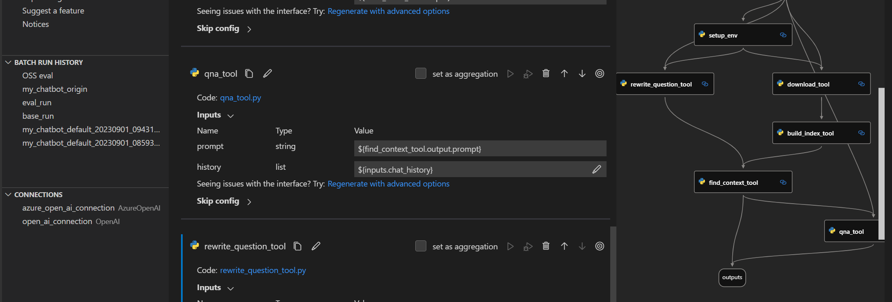

# Prompt flow

<p align="center">
  <a href="README.md">English</a> · <b>简体中文</b>
</p>

> [!WARNING]
> Microsoft Foundry 与 Azure Machine Learning 中的 Prompt flow 将于 2027 年 4 月 20 日正式退役。不再推荐将 Prompt flow 用于新项目开发。请在 2027 年 4 月 20 日之前将现有的 Prompt flow 应用与部署迁移至 Microsoft Agent Framework。
>
> Prompt flow 容器镜像已不再接收更新（包括安全更新与依赖包更新）。此政策适用于所有 Prompt flow 运行时镜像，包括 promptflow-runtime、promptflow-runtime-stable 以及 promptflow-python。
>
> 2027 年 4 月 20 日之后，Prompt flow（包括 Microsoft Foundry 与 Azure Machine Learning 中的 Web 可视化编排体验、VS Code 扩展程序以及相关的 Prompt flow 容器镜像）将不再受支持或提供服务。
>
> 如果您的应用程序依赖 Prompt flow 部署或运行时镜像，请规划在退役日期前将这些工作负载迁移至受支持的替代方案，例如 [Microsoft Agent Framework](https://learn.microsoft.com/en-us/agent-framework/)。有关迁移指南，请参阅 Prompt flow [迁移指南](https://learn.microsoft.com/en-us/azure/foundry-classic/how-to/prompt-flow-migration-overview) 以及迁移[代码示例](https://github.com/microsoft/promptflow/tree/main/migration-guide/PromptFlow-to-MAF)。

[](https://pypi.org/project/promptflow/)
[](https://pypi.python.org/pypi/promptflow/)
[](https://pypi.org/project/promptflow/)
[](https://microsoft.github.io/promptflow/reference/pf-command-reference.html)
[](https://marketplace.visualstudio.com/items?itemName=prompt-flow.prompt-flow)

[](https://microsoft.github.io/promptflow/index.html)
[](https://github.com/microsoft/promptflow/issues/new/choose)
[](https://github.com/microsoft/promptflow/issues/new/choose)
[](https://github.com/microsoft/promptflow/blob/main/CONTRIBUTING.md)
[](https://github.com/microsoft/promptflow/blob/main/LICENSE)

> 欢迎加入我们，共同让 Prompt flow 变得更出色！您可以参与[社区讨论 (Discussions)](https://github.com/microsoft/promptflow/discussions)、提交 [Issue 问题反馈](https://github.com/microsoft/promptflow/issues/new/choose) 或提交 [Pull Request](https://github.com/microsoft/promptflow/pulls)。

**Prompt flow** 是一套专为简化基于大语言模型（LLM）的 AI 应用全生命周期开发而设计的工具套件，涵盖创意构思、原型设计、测试验证、效果评估到生产部署与运行监控的完整闭环。它大幅简化了提示词工程（Prompt Engineering），赋能开发者构建具备生产级高品质的 LLM 应用程序。

使用 Prompt flow，您将能够：

- **创建并迭代开发 Flow（工作流）**
    - 创建可执行的 [Flow](https://microsoft.github.io/promptflow/concepts/concept-flows.html)，将 LLM、Prompt 提示词、Python 代码以及其他[工具 (Tools)](https://microsoft.github.io/promptflow/concepts/concept-tools.html) 无缝连接在一起。
    - 轻松调试与迭代 Flow，尤其是轻松[追踪（Trace）与 LLM 的交互全过程](https://microsoft.github.io/promptflow/how-to-guides/tracing/index.html)。
- **评估 Flow 的质量与性能**
    - 使用更大规模的数据集评估 Flow 的质量与性能表现。
    - 将测试与评估流程深度集成到 CI/CD 系统中，持续保障 Flow 的输出品质。
- **简化生产就绪交付周期**
    - 将 Flow 轻松部署至您所选的服务承载平台，或直接集成至现有应用程序的代码库中。
    - （可选但强烈推荐）借助 [Azure AI 中的 Prompt flow](https://learn.microsoft.com/en-us/azure/machine-learning/prompt-flow/overview-what-is-prompt-flow?view=azureml-api-2) 云端版本，与团队成员高效协同。

------

## 安装指南

为了快速上手，您可以使用预构建的开发环境。**点击下方按钮**即可直接在 GitHub Codespaces 中打开本代码库，随后继续阅读本指南！

[](https://codespaces.new/microsoft/promptflow?quickstart=1)

若您希望在本地环境中快速开始，请首先安装相应的软件包：

请确保已配置 Python 环境，推荐使用 `python>=3.9, <=3.11`。

```sh
pip install promptflow promptflow-tools
```

## 快速上手 ⚡

**使用 Prompt flow 创建聊天机器人 (Chatbot)**

运行以下命令从聊天模板初始化一个 Prompt flow，该命令将创建一个名为 `my_chatbot` 的文件夹并在其中生成所需文件：

```sh
pf flow init --flow ./my_chatbot --type chat
```

**配置 API 密钥连接 (Connection)**

针对 OpenAI 密钥，通过运行以下命令建立连接，该命令使用 `my_chatbot` 文件夹中的 `openai.yaml` 文件（该文件用于存储您的 OpenAI 密钥，可通过 `--set` 参数覆盖密钥与名称以避免直接修改 YAML 文件）：

```sh
pf connection create --file ./my_chatbot/openai.yaml --set api_key=<your_api_key> --name open_ai_connection
```

针对 Azure OpenAI 密钥，使用 `azure_openai.yaml` 文件运行以下命令建立连接：

```sh
pf connection create --file ./my_chatbot/azure_openai.yaml --set api_key=<your_api_key> api_base=<your_api_base> --name open_ai_connection
```

**与您的 Flow 进行对话交互**

在 `my_chatbot` 文件夹中，包含一个 `flow.dag.yaml` 文件，用于定义整个 Flow 的结构，包括输入/输出、节点、连接配置以及所使用的 LLM 模型等。

> 提示：在 `chat` 节点中，我们使用了名为 `open_ai_connection` 的连接（由 `connection` 字段指定）以及 `gpt-35-turbo` 模型（由 `deployment_name` 字段指定）。`deployment_name` 字段用于指定具体的 OpenAI 模型名称或 Azure OpenAI 部署资源名称。

运行以下命令与您的聊天机器人进行交互（按 `Ctrl + C` 可随时结束会话）：

```sh
pf flow test --flow ./my_chatbot --interactive
```

**核心价值：从原型到生产全流程保障“高品质”**

探索我们的 [**15 分钟快速教程**](examples/tutorials/flow-fine-tuning-evaluation/promptflow-quality-improvement.md)，该教程将引导您完成 提示词微调 ➡ 批量测试 ➡ 效果评估 的完整流程，旨在为生产部署提供坚实的质量保障。

下一步！请继续阅读下方的 **教程** 👇 章节以深入了解 Prompt flow。

## 教程 🏃‍♂️

Prompt flow 是一款专为**构建高品质 LLM 应用**而设计的工具。在 Prompt flow 中的开发流程遵循以下核心步骤：开发 Flow ➡ 提升 Flow 质量 ➡ 将 Flow 部署至生产环境。

### 开发您自己的 LLM 应用

#### VS Code 插件

我们还提供了一款 VS Code 扩展插件（Flow 可视化设计器），为您带来带有图形界面的交互式 Flow 开发体验。



您可以通过 <a href="https://marketplace.visualstudio.com/items?itemName=prompt-flow.prompt-flow">Visual Studio Marketplace</a> 轻松安装。

#### 深入探索 Flow 开发

[Prompt flow 入门指南](./docs/how-to-guides/quick-start.md)：一步步引导您完成第一次 Flow 运行的完整指南。

### 从实战用例中学习

[教程：与 PDF 文档对话 (Chat with PDF)](https://github.com/microsoft/promptflow/blob/main/examples/tutorials/e2e-development/chat-with-pdf.md)：展示如何使用 Prompt flow 构建高品质对话应用的端到端教程，涵盖 Flow 开发以及基于各项指标的效果评估。
> 更多丰富示例请参阅[示例库](https://microsoft.github.io/promptflow/tutorials/index.html#samples)。我们非常欢迎大家贡献新的实战用例！

### 贡献者开发环境搭建

如果您有兴趣参与项目贡献，请先阅读我们的开发环境搭建指南：[dev_setup.md](./docs/dev/dev_setup.md)。

下一步！请继续阅读下方的 **参与贡献** 👇 章节以了解如何为 Prompt flow 贡献力量。

## 参与贡献

本项目热烈欢迎大家的贡献与改进建议。绝大多数贡献都需要您签署《贡献者许可协议》（Contributor License Agreement, CLA），声明您有权且确实授予我们使用您所贡献内容的权利。详情请访问 https://cla.opensource.microsoft.com。

当您提交 Pull Request 时，CLA 机器人会自动检测您是否需要签署 CLA，并在 PR 中进行相应标注（例如状态检查、自动评论）。只需按照机器人提供的指引操作即可。在所有使用微软 CLA 的代码库中，您仅需签署一次。

本项目已采纳 [Microsoft 开源行为准则 (Microsoft Open Source Code of Conduct)](https://opensource.microsoft.com/codeofconduct/)。更多信息请参阅 [行为准则常见问题解答 (Code of Conduct FAQ)](https://opensource.microsoft.com/codeofconduct/faq/)，如有其他疑问或意见，欢迎联系 [opencode@microsoft.com](mailto:opencode@microsoft.com)。

## 商标声明

本项目可能包含某些项目、产品或服务的商标或徽标。对微软商标或徽标的授权使用受 [Microsoft 商标与品牌指南 (Microsoft's Trademark & Brand Guidelines)](https://www.microsoft.com/en-us/legal/intellectualproperty/trademarks/usage/general) 约束并必须严格遵守。在本项目修改版本中使用微软商标或徽标不得引起混淆或暗示微软的赞助支持。任何第三方商标或徽标的使用均受各第三方相应政策的约束。

## 行为准则

本项目已采纳 [Microsoft 开源行为准则 (Microsoft Open Source Code of Conduct)](https://opensource.microsoft.com/codeofconduct/)。更多信息请参阅 [行为准则常见问题解答 (Code of Conduct FAQ)](https://opensource.microsoft.com/codeofconduct/faq/)，如有任何其他问题或意见，欢迎随时联系 [opencode@microsoft.com](mailto:opencode@microsoft.com)。

## 数据收集与遥测

如果配置启用了遥测功能，该软件可能会收集有关您以及您对软件的使用信息，并将其发送给微软。微软可能会使用这些信息来提供服务并改进我们的产品与服务。您可以按照本仓库中描述的方法开启遥测。
该软件中的某些功能还可能允许您与微软从您应用程序的用户那里收集数据。如果您使用了这些功能，您必须遵守适用法律，包括向您应用程序的用户提供适当的告知，并附带一份微软隐私声明。我们的隐私声明位于：https://go.microsoft.com/fwlink/?LinkID=824704。您可以在帮助文档和我们的隐私声明中了解有关数据收集与使用的更多信息。您对该软件的使用即代表您同意这些惯例做法。

### 遥测配置

遥测收集功能默认处于开启状态。

如需关闭遥测收集，请运行命令 `pf config set telemetry.enabled=false` 将其关闭。

## 开源许可证

Copyright (c) Microsoft Corporation. All rights reserved.

基于 [MIT](LICENSE) 许可证授权。

---

> 💡 **文档维护说明**：本中文文档由社区志愿者（@JasonYeYuhe）翻译维护，最后同步更新于 2026年10月15日。如发现内容与官方英文原版存在差异或新特性滞后，欢迎提交 PR 共同完善！
